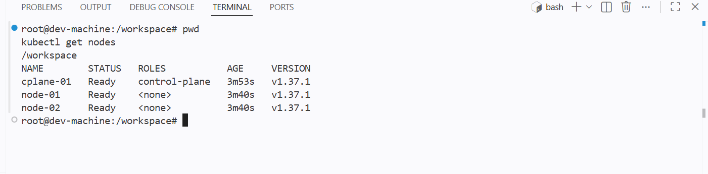
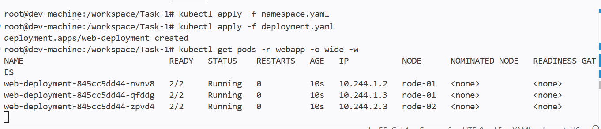
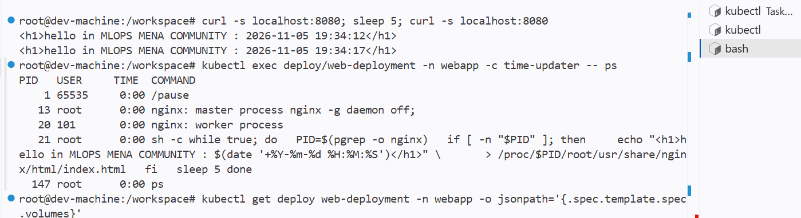
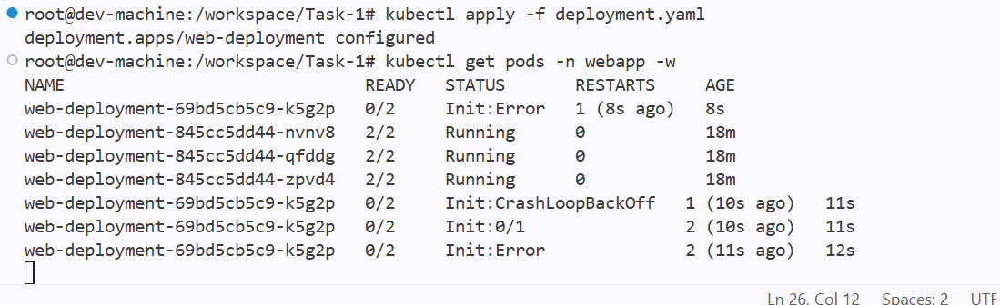
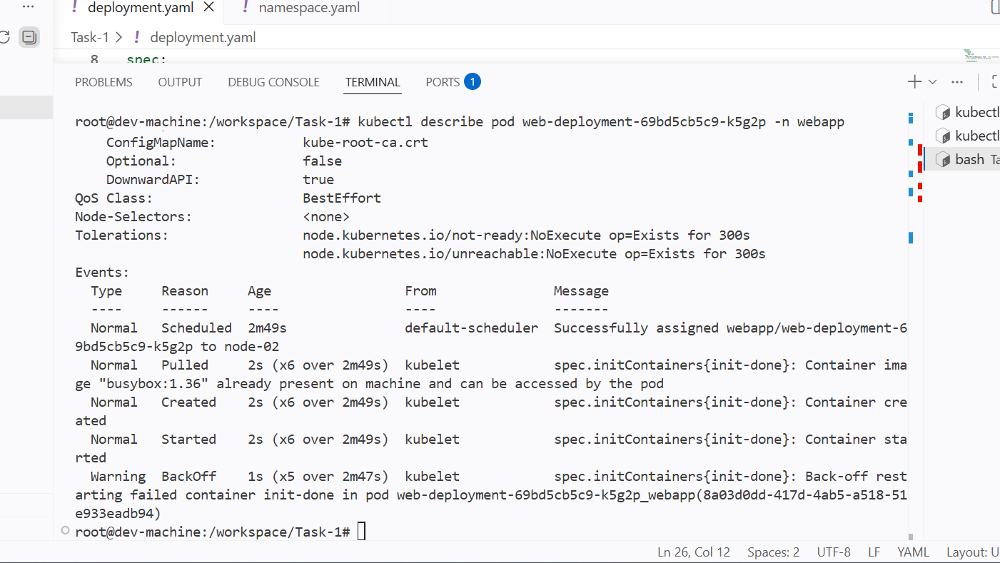
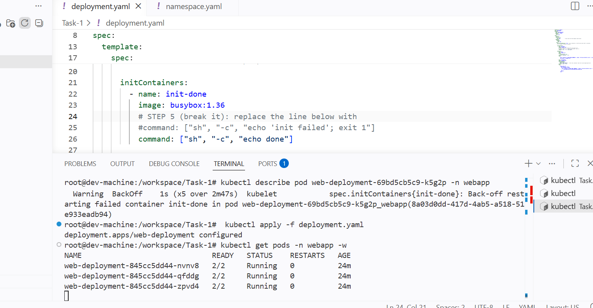
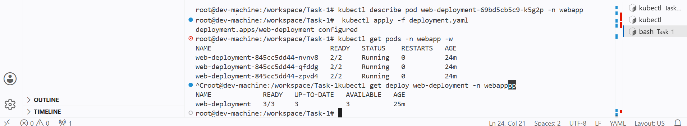

# Task 1 — Multi-container Pods (Init Container & Sidecar)

An nginx "hello" page that shows the current time, refreshed every 5 seconds by a sidecar,
with an init container that gates startup. No volumes: the sidecar writes into the nginx
container's filesystem through the shared process namespace (`/proc/<nginx-pid>/root`).

```text
<h1>hello in MLOPS MENA COMMUNITY : 2026-11-05 19:34:12</h1>
<h1>hello in MLOPS MENA COMMUNITY : 2026-11-05 19:34:17</h1>
```

## Environment

The course uses minikube; I used a **KubeLabs** kubeadm cluster with the same shape:
1 control plane + 2 workers, Kubernetes v1.37.1, containerd + flannel.
`kubectl` runs from the KubeLabs `dev-machine`, where the kubeconfig is provisioned.

| Course (minikube) | Mine (KubeLabs) |
|---|---|
| `minikube` (control plane) | `cplane-01` |
| `minikube-m02` (worker) | `node-01` |
| `minikube-m03` (worker) | `node-02` |

Container clocks run in UTC, so the page shows times 2 hours behind Cairo (UTC+2).

## Files

| File | Purpose |
|---|---|
| `namespace.yaml` | Namespace `webapp` |
| `deployment.yaml` | Deployment `web-deployment`: 3 replicas, label `app: web`, `init-done` + `nginx` + `time-updater` |
| `screenshots/` | Terminal output for every step |

## Pod design

| Container | Type | Image | Job |
|---|---|---|---|
| `init-done` | init | `busybox:1.36` | `echo done`, exit 0. Nothing else starts until it succeeds. |
| `nginx` | main | `nginx:1.27` | Writes `index.html` with the time, then `exec nginx -g 'daemon off;'` on port 80 |
| `time-updater` | sidecar | `busybox:1.36` | Every 5 s: finds nginx with `pgrep -o nginx`, rewrites `/proc/$PID/root/usr/share/nginx/html/index.html`. Needs `SYS_PTRACE`. |

`shareProcessNamespace: true` puts all containers in one process list, so the sidecar can see
nginx's PID. Linux exposes each process's filesystem at `/proc/<pid>/root`, which is how the
sidecar reaches nginx's files without a shared volume.

## 1. Cluster

```bash
kubectl get nodes
```
All 3 nodes are `Ready` on v1.37.1.



## 2. Deploy

```bash
kubectl apply -f namespace.yaml
kubectl apply -f deployment.yaml
kubectl get pods -n webapp -o wide -w
```
3 Pods `2/2 Running`: two on `node-01`, one on `node-02`. The control plane is tainted, so no
Pods run there. READY is `2/2` because the init container has finished and only `nginx` and
`time-updater` are counted.



## 3. Verify the page, the sidecar and "no volumes"

```bash
kubectl port-forward -n webapp deploy/web-deployment 8080:80     # separate terminal
curl -s localhost:8080; sleep 5; curl -s localhost:8080
kubectl exec deploy/web-deployment -n webapp -c time-updater -- ps
kubectl get deploy web-deployment -n webapp -o jsonpath='{.spec.template.spec.volumes}'
```

- `curl` returns `19:34:12` then `19:34:17`: the sidecar rewrote the page 5 s later.
- `ps` run **inside `time-updater`** lists `nginx: master process` as PID 13, next to the
  sidecar's own loop (PID 21) and `/pause` (PID 1). That is the shared process namespace:
  `pgrep -o nginx` returns 13, so the sidecar writes to `/proc/13/root/usr/share/nginx/html/index.html`.
- The `volumes` query prints nothing: the Pod has no volumes.



| # | Check | Result |
|---|---|---|
| 1 | 3 nodes Ready | ✅ `cplane-01`, `node-01`, `node-02` |
| 2 | Deployment READY 3/3 | ✅ |
| 3 | 3 Pods `2/2 Running` | ✅ |
| 6 | sidecar `ps` shows `nginx: master process` | ✅ PID 13 |
| 7 | page time changes after 5 s | ✅ 19:34:12 → 19:34:17 |
| 8 | `.spec.template.spec.volumes` empty | ✅ |

## 4. Break the init container

Changed only the init command and re-applied the same file (no delete):

```yaml
command: ["sh", "-c", "echo 'init failed'; exit 1"]
```
```bash
kubectl apply -f deployment.yaml          # deployment.apps/web-deployment configured
kubectl get pods -n webapp -w
```



The change created a new ReplicaSet (`69bd5cb5c9`) next to the working one (`845cc5dd44`):

| Pod | READY | STATUS |
|---|---|---|
| `web-deployment-69bd5cb5c9-k5g2p` (new) | 0/2 | `Init:Error` → `Init:CrashLoopBackOff` → `Init:0/1` → `Init:Error` … |
| `web-deployment-845cc5dd44-nvnv8` (old) | 2/2 | Running |
| `web-deployment-845cc5dd44-qfddg` (old) | 2/2 | Running |
| `web-deployment-845cc5dd44-zpvd4` (old) | 2/2 | Running |

```bash
kubectl describe pod web-deployment-69bd5cb5c9-k5g2p -n webapp
```
The events show the kubelet on `node-02` started `init-done` 6 times in 2m49s, with 5
`BackOff` warnings: *Back-off restarting failed container init-done*.



### Answers

**Which status does the new Pod show?**
`Init:Error`, then `Init:CrashLoopBackOff`, READY `0/2`. The init container exits with code 1,
and Kubernetes keeps restarting it with a growing delay (10 s, 20 s, 40 s … up to 5 min).

**Do `nginx` and `time-updater` start?**
No. Regular containers only start after every init container exits with code 0, so both stay
waiting in `PodInitializing`. That's why READY never leaves `0/2`.

**Is the page still reachable, and why?**
Yes. The change triggers a rolling update with the default strategy: `maxSurge: 25%` and
`maxUnavailable: 25%`. For 3 replicas that is 1 extra Pod allowed and 0 Pods allowed to go
missing. So Kubernetes created **one** new Pod and kept all 3 old Pods until the new one became
Ready. It never did, so no old Pod was removed: the rollout stalled with zero downtime, and the
port-forward kept serving from an old Pod.

## 5. Fix

Restored `command: ["sh", "-c", "echo done"]` and re-applied.



The Pod template now matches the working `845cc5dd44` ReplicaSet again, so Kubernetes scaled
that one back to 3 and deleted the broken Pod. The 3 Pods are the **same** ones from the start
(`nvnv8`, `qfddg`, `zpvd4`, 24 minutes old, 0 restarts): they never stopped.



| # | Check | Result |
|---|---|---|
| 9 | Failing init: new Pod `Init:CrashLoopBackOff`, old 3 Pods `2/2 Running` | ✅ |
| 10 | Init error details in `describe` | ✅ BackOff restarting failed container `init-done` |
| 11 | Fixed: READY `3/3`, UP-TO-DATE `3` | ✅ |
