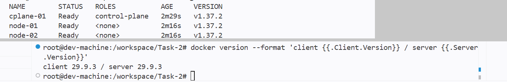
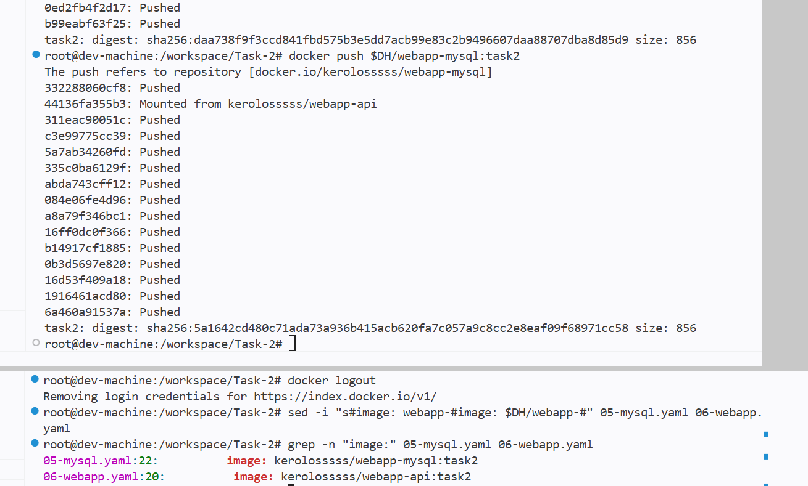
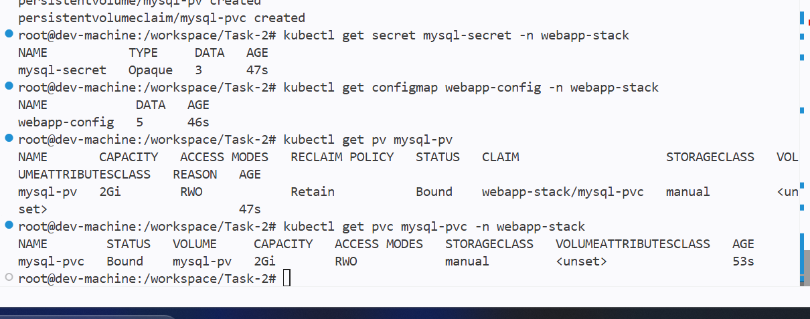
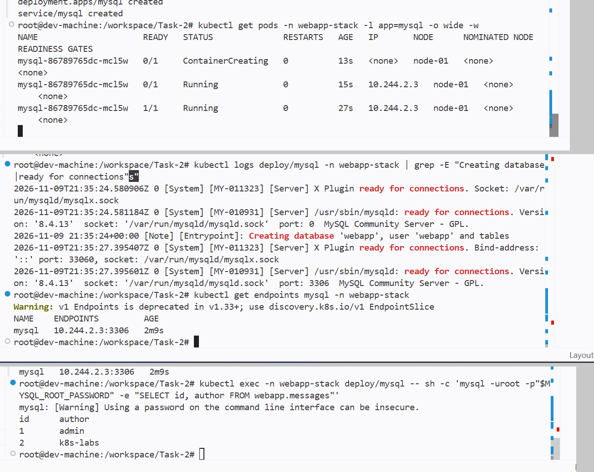
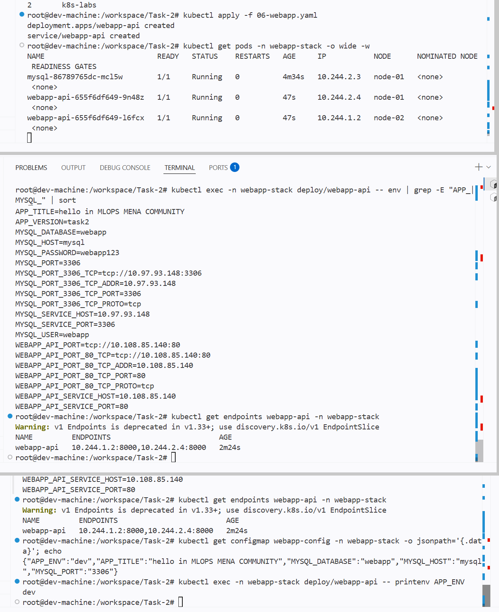
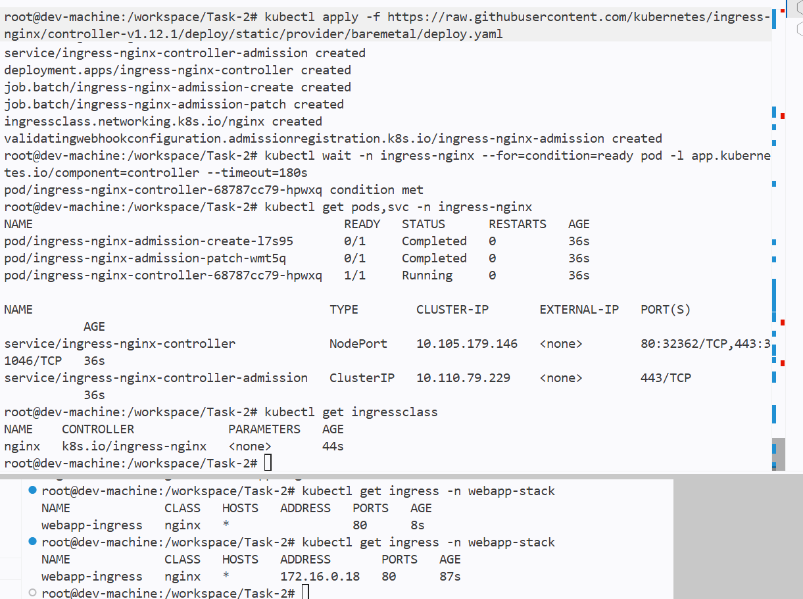
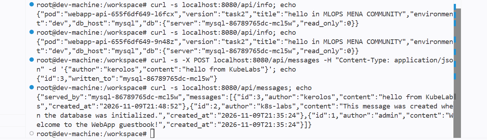
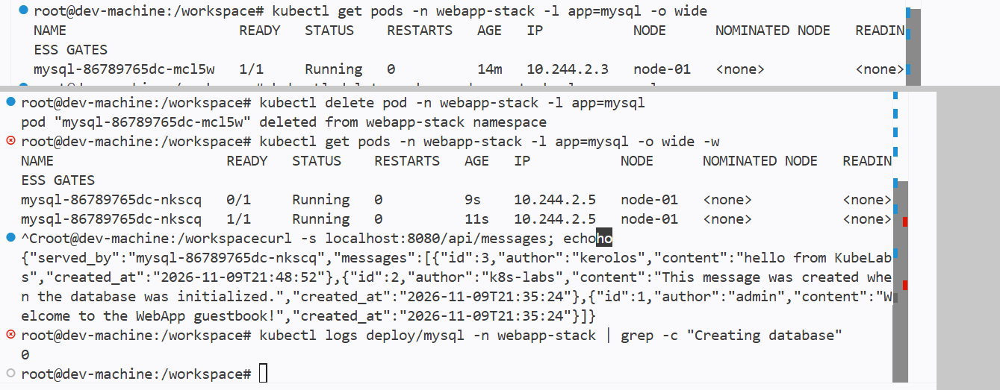

# Task 2 — FastAPI + MySQL with ConfigMap, Secret, PV/PVC and Ingress

A guestbook API (FastAPI, 2 replicas) backed by MySQL (1 replica). Configuration lives in a
ConfigMap and a Secret, MySQL data lives on a `hostPath` PersistentVolume pinned to one node,
and everything is reached through an NGINX Ingress.

```text
curl → Ingress controller → Ingress webapp-ingress (/) → Service webapp-api:80 → 2 FastAPI Pods :8000
                                                       → Service mysql:3306 → MySQL Pod → PVC → PV (node-01)
```

## Environment

The course uses minikube; I used a **KubeLabs** kubeadm cluster (Kubernetes v1.37.2,
containerd + flannel). Commands run from the KubeLabs `dev-machine`.

| Course (minikube) | Mine (KubeLabs) | Why |
|---|---|---|
| `minikube-m02` | `node-01` | first worker, used in the PV's nodeAffinity |
| `minikube image load` | images pushed to Docker Hub (`kerolosssss/webapp-api:task2`, `kerolosssss/webapp-mysql:task2`) | nodes must pull the images from a registry |
| `minikube addons enable ingress` | official ingress-nginx **bare-metal** manifest (controller v1.12.1) | no minikube addons on kubeadm |
| `minikube ssh` | KubeLabs node terminal | to reach the node's disk |

Docker was not installed on the dev-machine, so I installed it with the official `get.docker.com`
script. The install paused on a hidden dpkg question about the existing
`/etc/containerd/config.toml`; I answered **N** to keep the existing file.

Container clocks are UTC, so the timestamps below are 2 hours behind Cairo.

## Files

| File | Creates |
|---|---|
| `01-namespace.yaml` | Namespace `webapp-stack` |
| `02-secret.yaml` | Secret `mysql-secret`: `root-password`, `app-user`, `app-password` |
| `03-configmap.yaml` | ConfigMap `webapp-config`: `APP_TITLE`, `APP_ENV`, `MYSQL_HOST`, `MYSQL_PORT`, `MYSQL_DATABASE` |
| `04-pv-pvc.yaml` | PV `mysql-pv` (2Gi, RWO, `Retain`, `manual`, hostPath `/data/webapp-mysql`, nodeAffinity `node-01`) + PVC `mysql-pvc` |
| `05-mysql.yaml` | Deployment `mysql` (1 replica, `Recreate`, probes, PVC at `/var/lib/mysql`) + ClusterIP Service `mysql:3306` |
| `06-webapp.yaml` | Deployment `webapp-api` (2 replicas, `envFrom` ConfigMap, Secret keys, `/health` probes) + ClusterIP Service `webapp-api` 80 → 8000 |
| `07-ingress.yaml` | Ingress `webapp-ingress`, class `nginx`, path `/` (Prefix) → `webapp-api:80` |
| `webapp/`, `mysql/` | Course source code and Dockerfiles, unchanged |

## 1. Cluster and Docker



## 2. Build and push the images

```bash
docker build -t $DH/webapp-api:task2   ./webapp
docker build -t $DH/webapp-mysql:task2 ./mysql
docker push $DH/webapp-api:task2
docker push $DH/webapp-mysql:task2
docker logout
sed -i "s#image: webapp-#image: $DH/webapp-#" 05-mysql.yaml 06-webapp.yaml
```
Both repositories are public, so the nodes pull them without credentials.
`Mounted from kerolosssss/webapp-api` means a layer already in the first repository was reused instead of uploaded twice.



## 3. Secret, ConfigMap, PV and PVC

```bash
kubectl apply -f 01-namespace.yaml -f 02-secret.yaml -f 03-configmap.yaml -f 04-pv-pvc.yaml
```
The Secret has 3 keys, the ConfigMap 5. The PVC asks for exactly what the PV offers
(2Gi, RWO, class `manual`, `volumeName: mysql-pv`), so both are **Bound**.



## 4. MySQL

```bash
kubectl apply -f 05-mysql.yaml
```
- `mysql-86789765dc-mcl5w` was scheduled on **node-01**, the only node the PV allows, and was ready in 27 s.
- The log shows the first start: a temporary server on `port: 0`, then
  `Creating database 'webapp', user 'webapp' and tables` (the init script, which only runs on an empty folder), then the real server on `port: 3306`.
- The `mysql` Service endpoint `10.244.2.3:3306` is the Pod's IP.
- The 2 default rows exist.



## 5. The app

```bash
kubectl apply -f 06-webapp.yaml
```
- 2 replicas, one per worker: `9n48z` on node-01 and `l6fcx` on node-02.
- Env inside the container: all 5 ConfigMap keys plus `MYSQL_USER` and `MYSQL_PASSWORD` from the Secret.
  `MYSQL_PORT=3306` is a plain number: the ConfigMap overrides the `MYSQL_PORT=tcp://...` variable Kubernetes injects for the `mysql` Service, which the app couldn't parse.
- The `webapp-api` Service has 2 endpoints on port 8000.



## 6. Ingress controller and Ingress

```bash
kubectl apply -f https://raw.githubusercontent.com/kubernetes/ingress-nginx/controller-v1.12.1/deploy/static/provider/baremetal/deploy.yaml
kubectl wait -n ingress-nginx --for=condition=ready pod -l app.kubernetes.io/component=controller --timeout=180s
kubectl apply -f 07-ingress.yaml
```
- Controller `1/1 Running`; the two admission jobs are `Completed` (their success state).
- Bare-metal Service type is `NodePort` (`80:32362`).
- IngressClass `nginx`; the Ingress got ADDRESS `172.16.0.18` after about a minute.



## 7. Access through the Ingress

```bash
kubectl port-forward -n ingress-nginx svc/ingress-nginx-controller 8080:80   # separate terminal
curl -s localhost:8080/api/info
curl -s -X POST localhost:8080/api/messages -H "Content-Type: application/json" \
     -d '{"author":"kerolos","content":"hello from KubeLabs"}'
curl -s localhost:8080/api/messages
```

| Output | Shows |
|---|---|
| `"pod"` alternates `…-l6fcx` / `…-9n48z` | the Service load-balances across both replicas |
| `"version":"task2"` | my image is running |
| `"title"`, `"environment":"dev"`, `"db_host":"mysql"` | the ConfigMap reached the app |
| `"db":{"server":"mysql-86789765dc-mcl5w"}` | Secret credentials work, `mysql` resolves through cluster DNS |
| `{"id":3,"written_to":…}` | write works |
| messages 3, 2, 1 | read works: my message plus the 2 defaults |



## 8. Persistence test

```bash
kubectl delete pod -n webapp-stack -l app=mysql
kubectl get pods -n webapp-stack -l app=mysql -o wide -w
curl -s localhost:8080/api/messages
kubectl logs deploy/mysql -n webapp-stack | grep -c "Creating database"
```

| | Before | After |
|---|---|---|
| Pod | `mysql-86789765dc-mcl5w` | `mysql-86789765dc-nkscq` |
| IP | `10.244.2.3` | `10.244.2.5` |
| Node | node-01 | node-01 |
| Ready after | 27 s (first-time setup) | 11 s (existing data) |

My message `id 3` (created `2026-11-09T21:48:52`) is still returned, now `served_by` the new Pod,
and `Creating database` appears **0** times in the new Pod's log: it never re-ran the init script.



### Why the data survived

1. The Deployment saw 0 of 1 MySQL Pods and created a new one.
2. The PV's `nodeAffinity` only allows `node-01`, so the scheduler placed the new Pod there.
3. The new Pod mounted the same claim, so the same folder `/data/webapp-mysql`, at `/var/lib/mysql`.
4. MySQL found an initialized data directory, skipped setup and served the existing rows.

Without `nodeAffinity`, the new Pod could have landed on node-02, which has its own empty
`/data/webapp-mysql`, and MySQL would have started a fresh, empty database.

## Design notes

- **MySQL uses `Recreate`, 1 replica**: two MySQL servers on one data folder would corrupt it.
  A rolling update would briefly run old and new together; `Recreate` stops the old Pod first.
- **The app uses 2 replicas**: it is stateless, so any copy can serve any request.
- **Secrets are applied once**: the init script creates the MySQL user with the password from the
  Secret at first start only. Changing the Secret later gives `Access denied` until the data folder
  on node-01 is emptied and MySQL re-initializes.
- **Liveness waits 60 s for MySQL** so the first-time setup is not killed halfway.

## Verification

| # | Check | Result |
|---|---|---|
| 1 | Images on Docker Hub | ✅ `kerolosssss/webapp-api:task2`, `kerolosssss/webapp-mysql:task2` |
| 2 | Secret and ConfigMap | ✅ DATA 3 and 5 |
| 3 | PV and PVC | ✅ both Bound, 2Gi |
| 4 | Deployments | ✅ mysql 1/1, webapp-api 2/2 |
| 5 | MySQL on the PV node | ✅ node-01 |
| 6 | App env | ✅ ConfigMap keys + `MYSQL_USER`/`MYSQL_PASSWORD` |
| 7 | Default data | ✅ 2 rows |
| 8 | Ingress | ✅ class nginx, ADDRESS 172.16.0.18 |
| 9 | `/api/info` | ✅ version task2, environment dev, db.server = MySQL Pod |
| 10 | POST message | ✅ id 3 |
| 11 | GET messages | ✅ 3 messages |
| 12 | Survives MySQL Pod deletion | ✅ id 3 still there, served by the new Pod |
